# 구르는 가이드 (Rolling Guide)

**버튼 하나면 차가 통째로 여행 어드벤처가 됩니다.**

차의 조명과 소리, 화면, 내비게이션, 공조, 글로브 박스까지 함께 움직여 지나는 곳마다 이야기를 들려주고, 창밖이 궁금하면 말로 물어보고, 뒷자리 아이는 퀴즈로 보물 상자를 열고, 그날 하루를 기록으로 남겨 주는 Pleos Connect 여행 가이드 앱입니다. 현대자동차그룹 차량용 앱 개발 공모전 출품작입니다.

## 시연 영상

**[시연 영상 보기 (8분 28초, 브라우저에서 바로 재생)](https://aikong2024.github.io/gureuneun-guide/)**

[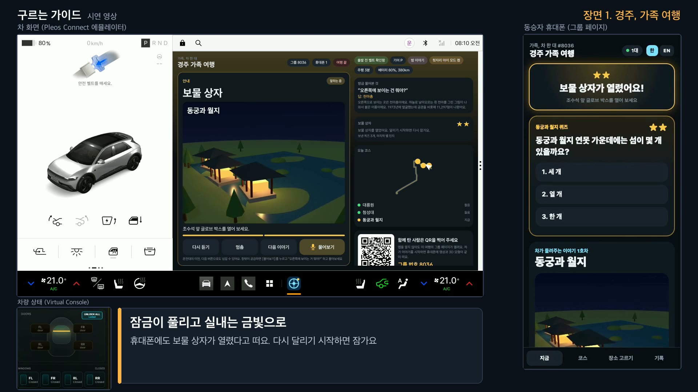](https://aikong2024.github.io/gureuneun-guide/)

영상 파일은 [docs/demo/gureuneun-guide-demo.mp4](docs/demo/gureuneun-guide-demo.mp4)에도 있습니다 (MP4, 34MB). 재생 페이지의 단추로 장면에 바로 갈 수 있습니다: 0:56 말로 묻기, 1:33 뒷자리 아이 퀴즈, 3:13 글로브 박스 보물 상자, 3:36 제주, 5:41 사진과 빌트인 캠 기록, 6:15 서울, 7:00 영어로 묻기, 7:25 먼 길에서 차가 먼저 챙기는 것.

Pleos Connect 에뮬레이터에서 앱이 실제로 돌아가는 화면을 녹화했습니다. 왼쪽이 차 화면, 오른쪽이 동승자 휴대폰, 왼쪽 아래가 Virtual Console의 차량 상태(실내 조명 색, 창문)입니다. 소리는 에뮬레이터 속 차가 Pleos TextToSpeech로 낸 안내 음성을 그대로 담았습니다. 차 소리를 파일로 받으려고 에뮬레이터 소리 장치를 파일 모드로 띄워서 녹화 중에는 마이크 입력이 들어오지 않습니다. 그래서 말로 묻는 장면은 녹음한 질문 목소리를 SpeechToText SDK에 그대로 넣어 인식시켰고, 그 목소리를 영상 소리에도 겹쳤습니다. 인식 결과와 답은 앱이 실제로 낸 것입니다.

| 장면 | 보여 주는 것 |
|---|---|
| 1. 경주, 가족 여행 | [여행 시작] 한 번으로 내비게이션 경로와 좌석 점호, 도시에 들어설 때 바뀌는 조명과 오프닝, "오른쪽에 보이는 거 뭐야?"에 코스 밖 천마총까지 답하기, 명소 안내, 뒷자리 아이 이야기와 휴대폰 퀴즈, 방향지시등, 비와 밤 이야기, 별을 다 모으면 열리는 글로브 박스 보물 상자, 주차 화면 |
| 2. 제주, 친구들의 렌터카 두 대 | 그룹 묶기, 휴대폰에서 고른 카페가 내비게이션으로, 뒤차가 보낸 주차장, 손으로 돌려 보는 3D 모형, 바다에 들어서면 바깥 공기, 바닷가 창문과 파도 소리, 하루 기록 카드, 사진과 빌트인 캠 하이라이트 |
| 3. 서울, 외국인 손님을 태운 택시 | 차 음성과 휴대폰 화면이 모두 영어로 안내, 손님이 영어로 물어도 영어로 답하기 |
| 4. 먼 길에서 차가 먼저 챙기는 것 | "배터리 얼마나 남았어?", 막히는 길에서는 긴 이야기, 두 시간 넘게 달리면 쉬어 가자고 하고 순정 내비에서 휴게소 찾기, 배터리가 빠듯하면 순정 내비에 주변 충전소 |

## 화면

| 출발 전 좌석 점호 | 달리는 동안 (소리로 안내) | 차가 서면 명소 장면과 QR |
|---|---|---|
| 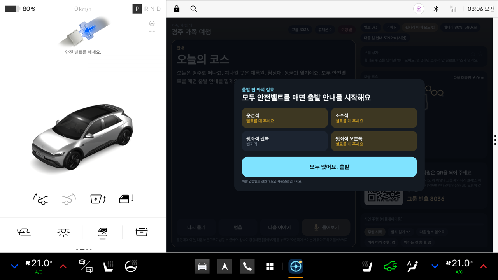 | 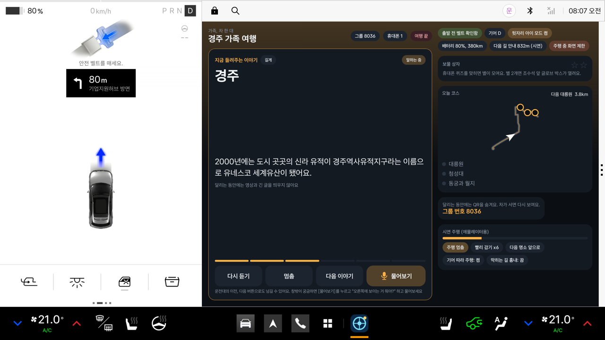 | 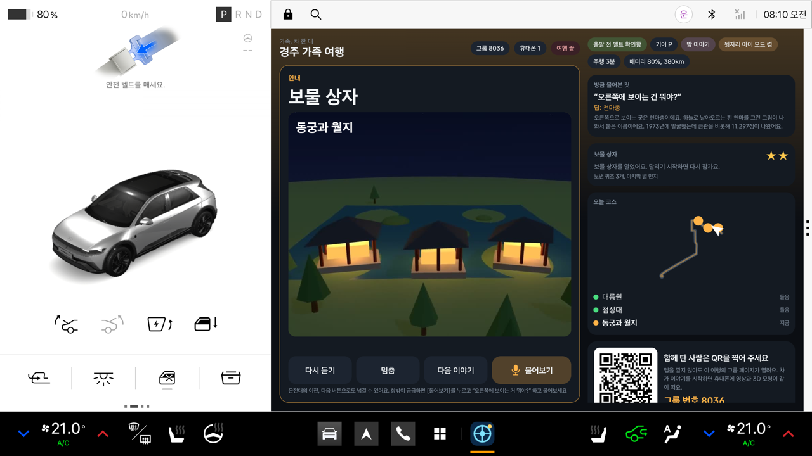 |

| "오른쪽에 보이는 거 뭐야?" 코스 밖 천마총까지 | 영어로 물어도 영어로 (마포대교) | 별을 다 모으고 세우면 보물 상자 |
|---|---|---|
| 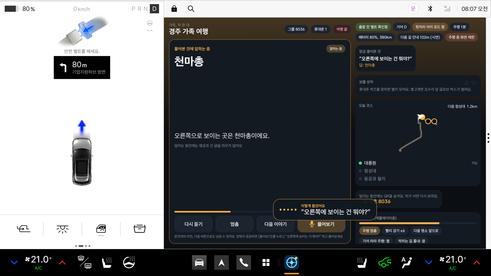 | 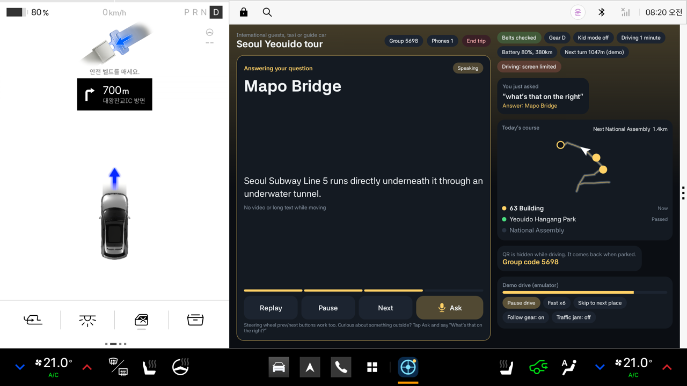 | 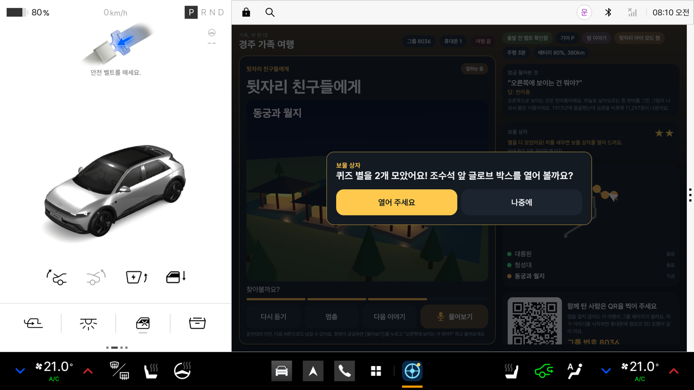 |

| 두 시간 넘게 달리면 쉬어 가자고 | 누르면 순정 내비에 주변 충전소 | 하루 기록 카드 |
|---|---|---|
| 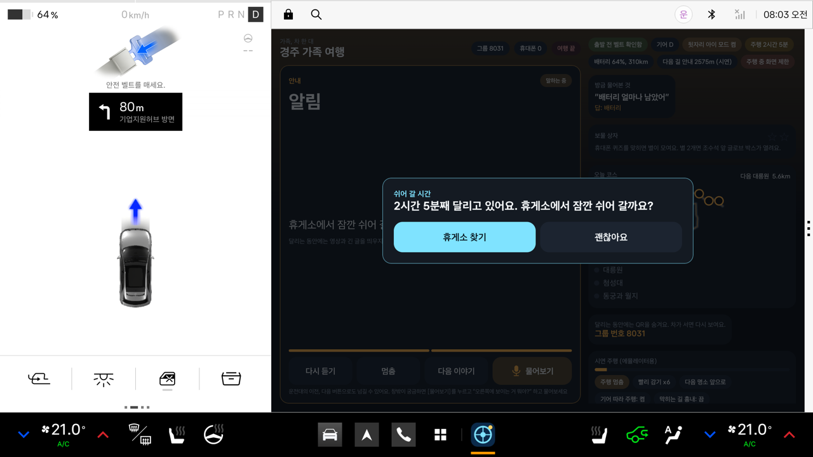 | 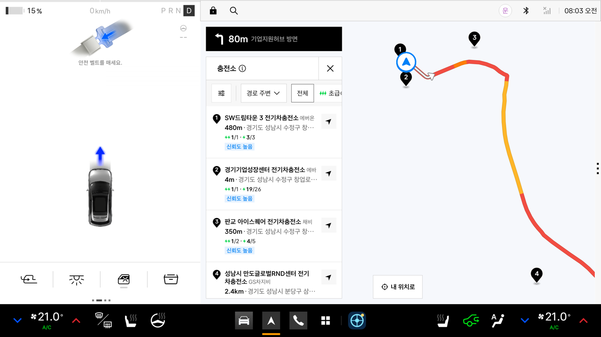 | 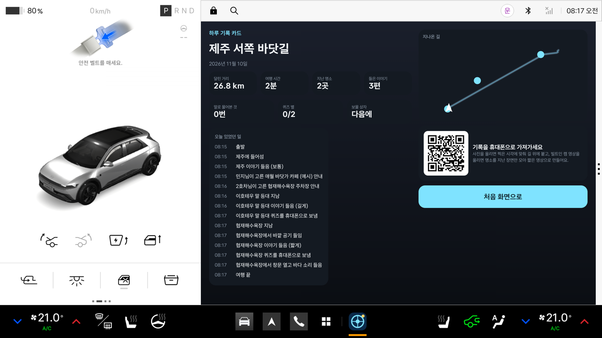 |

| 휴대폰에서 고른 카페, 운전자는 확인만 | 바닷가에 세우면 창문을 열지 물음 |
|---|---|
| 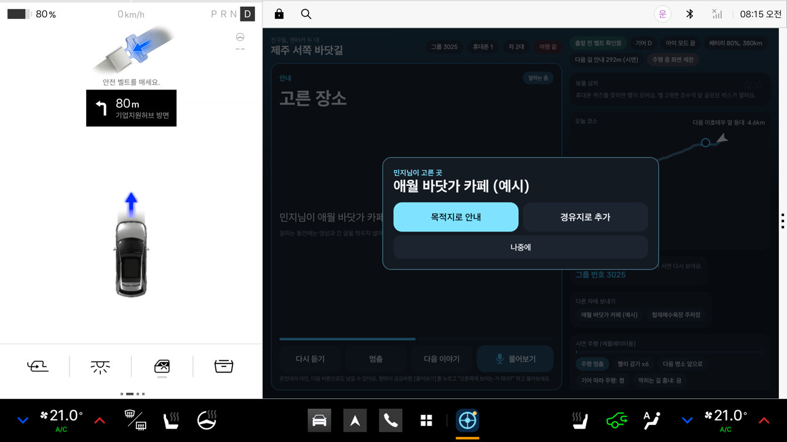 | 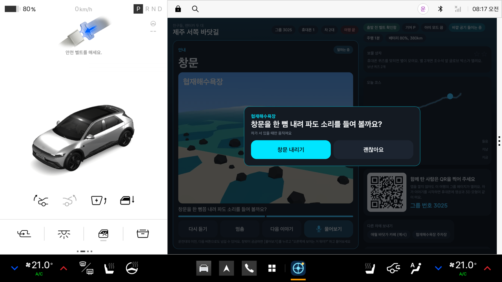 |

| 휴대폰: 지금 듣는 이야기와 퀴즈 | 휴대폰: 맞히면 별 | 휴대폰: 보물 상자 | 휴대폰: 장소 고르기 | 휴대폰: 사진과 하이라이트 | 휴대폰: 영어 안내 |
|---|---|---|---|---|---|
| 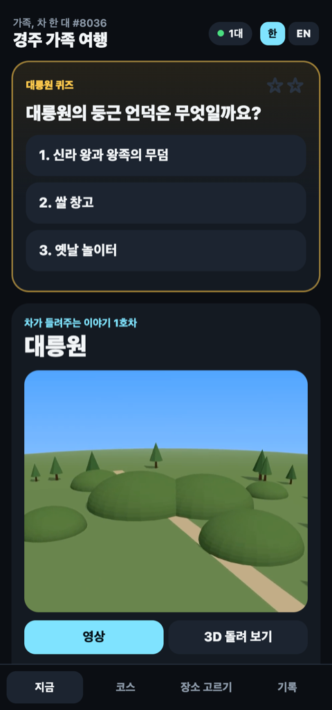 | 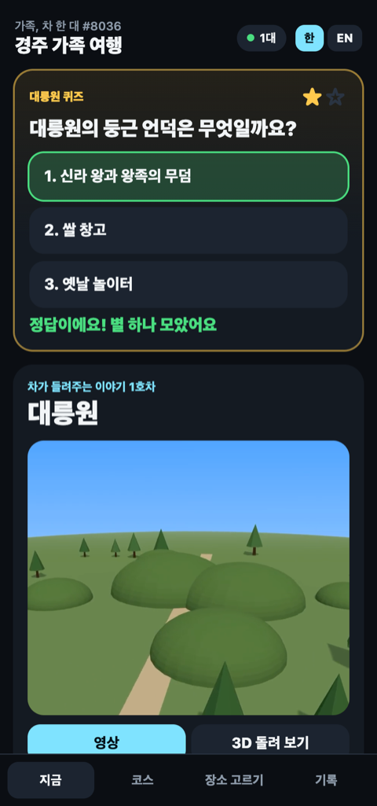 | 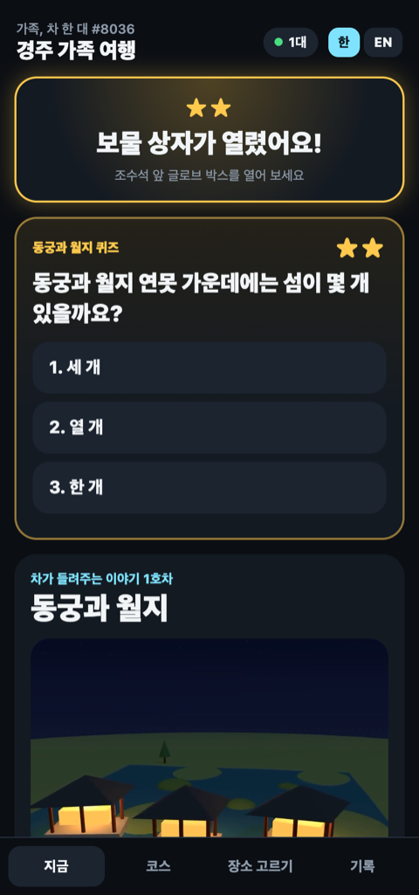 | 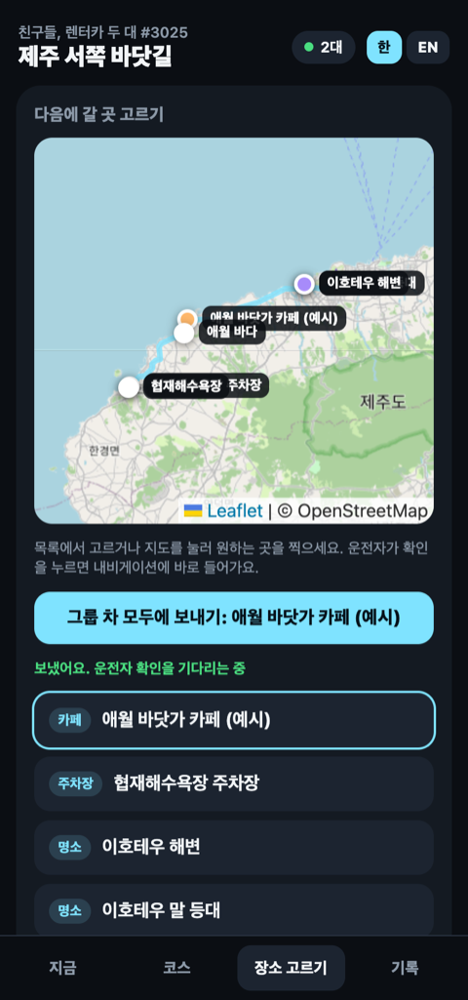 | 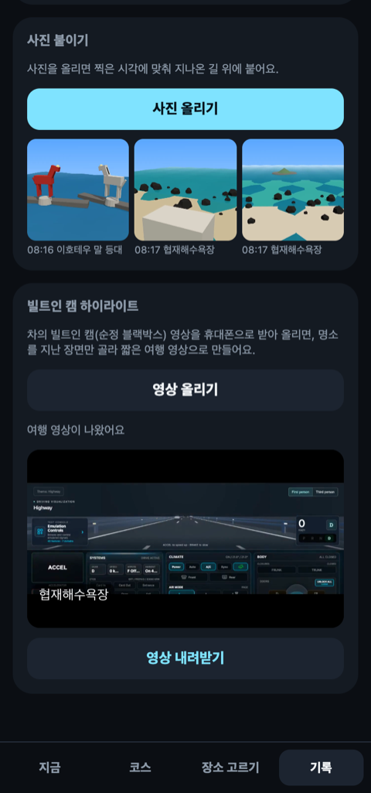 | 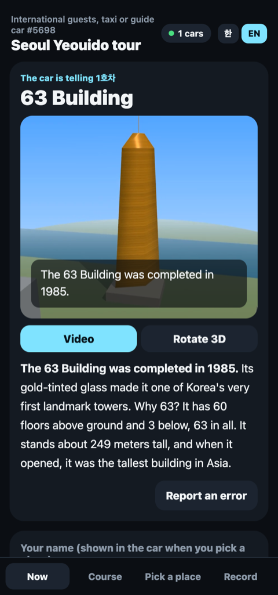 |

## APK

- 파일: [apk/개인참가_구르는가이드_release.apk](apk/개인참가_구르는가이드_release.apk) (release 서명, 43MB)
- 대상: Pleos Connect 에뮬레이터 (Android 14, API 34, Car 이미지). minSdk 28

## 무엇을 하나요

[여행 시작]을 누르면 아래가 한꺼번에 움직입니다.

1. **내비게이션**: 오늘 목적지와 경유지 두 곳을 순정 내비게이션에 넣습니다 (NaviHelper).
2. **좌석 점호**: 앉은 자리가 모두 벨트를 매면 출발 안내를 시작합니다 (Vehicle 좌석, 벨트).
3. **도시 오프닝과 명소 안내**: 여행지와 명소마다 영역을 정해 두고 차가 들어서는 순간 실내 조명 색이 바뀌고 이야기가 시작됩니다. "잠시 후 오른쪽에 첨성대가 보여요"처럼 어느 쪽에 보일지도 먼저 알려 줍니다. 하던 이야기가 남아 있어도 새 명소가 나타나면 그 문장까지만 하고 명소 안내로 넘어가고, 이미 지나친 명소 안내는 건너뜁니다 (FusedLocation 근접 알림, Vehicle 실내 조명, TextToSpeech).
4. **길 안내와 겹치지 않게**: 다음 길 안내까지 남은 거리를 보고 이야기 길이(짧게, 보통, 길게)를 고르고, 안내 지점이 가까우면 잠시 쉬었다가 이어 갑니다 (NaviHelper TBT).
5. **차 상태에 맞춘 이야기**: 방향지시등을 켜면 멈추고 끄면 이어서, 와이퍼가 움직이면 비 오는 날 이야기, 전조등이 켜지면 밤 이야기로 바꿉니다. 비가 오거나 전조등이 켜지면 하던 이야기 사이에 바로 알려 주고 이어 갑니다 (Vehicle).
6. **주행 규제**: 달리는 동안에는 차 화면의 영상과 QR, 긴 글을 숨기고 소리로만 안내합니다. 차가 서면 명소 장면과 QR을 크게 보여 줍니다 (CarUxRestrictions).
7. **운전대 버튼**: 이야기를 미디어 세션으로 만들어 운전대의 이전, 다음 버튼으로 다시 듣거나 넘깁니다.
8. **창문**: 바닷가 명소에 차를 세우면 창문을 조금 열지 먼저 묻고, 확인을 누를 때만 한 뼘쯤 내립니다 (Vehicle 창문).
9. **함께 보는 휴대폰 화면**: 차 화면의 QR을 찍으면 앱 설치 없이 그룹 페이지가 열립니다. 차가 이야기를 시작하는 순간 휴대폰에도 같은 명소의 짧은 영상과 손으로 돌려 보는 3D 모형, 자막이 뜹니다.
10. **차 여러 대**: 네 자리 그룹 번호로 차들을 묶습니다. 휴대폰 지도에서 고른 카페나 주차장이 운전자 확인 한 번으로 그룹 차 모두의 내비게이션에 들어갑니다. 차의 실시간 위치는 주고받지 않습니다.
11. **영어 안내**: 안내 언어를 영어로 바꾸면 차 음성과 휴대폰 화면이 모두 영어로 바뀝니다 (서울 시나리오).
12. **하루 기록 카드**: 지나온 길, 명소를 지난 시각, 들은 이야기를 모아 보여 줍니다. 휴대폰 사진은 찍은 시각에 맞춰 길 위에 붙고, 빌트인 캠 영상을 올리면 명소를 지난 장면만 골라 짧은 여행 영상으로 만듭니다.
13. **말로 묻기 ("저거 뭐야?")**: [물어보기]를 누르고 "오른쪽에 보이는 거 뭐야?" 하고 물으면 차 마이크로 듣고(SpeechToText, ON_DEVICE), 지금 위치와 진행 방향으로 그쪽에 보이는 곳을 골라 "오른쪽으로 보이는 곳은 천마총이에요. ... 여기서 약 150미터 떨어져 있어요"처럼 답합니다. 이야기 정류장이 아닌 볼거리(천마총, 계림, 월성, 마포대교, 서강대교, 비양도 등 13곳)도 알고, 지금 들려주는 명소를 물으면 같은 이야기를 되풀이하지 않고 짧게 짚어 줍니다. 듣는 동안에는 이야기를 멈추고, 답이 끝나면 끊긴 문장부터 이어 갑니다. 물어본 것과 답은 휴대폰에도 같이 뜹니다.
14. **말로 하는 조작**: "다시", "다음 이야기", "잠깐 멈춰", "계속", "얼마나 남았어?", "여기 어디야?", "퀴즈 내 줘", "화장실 가고 싶어", "배터리 얼마나 남았어?", "좀 더운데"(설정 온도 1도 내림), "창문 열어 줘"(서 있을 때만), "아이 모드 켜 줘", "다른 차에 주차장 보내 줘"를 알아듣습니다. 차 안 음성 인식은 끝이 잘리거나 조사가 바뀌어 들어오는 일이 많아서 문장을 통째로 맞추지 않고 낱말 조각으로 판단합니다 ([Ask.kt](app/src/main/java/app/gureuneun/guide/engine/Ask.kt), 단위 시험 포함).
15. **뒷자리 아이 모드와 퀴즈**: 뒷좌석에 사람이 앉으면(Vehicle 좌석 착석) 아이 모드가 켜져 명소 이야기 끝에 뒷자리 친구들 이야기를 짧게 덧붙이고, 휴대폰으로 그 명소 퀴즈를 보냅니다. 보기 순서는 낼 때마다 섞고, 채점은 그룹 서버가 해서 휴대폰에는 정답을 미리 보내지 않습니다.
16. **글로브 박스 보물 상자**: 퀴즈 별을 정해진 만큼(경주, 제주 2개) 모으고 차를 P에 세우면 "보물 상자를 열어 볼까요?" 하고 묻고, 운전자가 누를 때만 글로브 박스 잠금을 풉니다. 실내 조명이 금빛으로 바뀌고 휴대폰에도 소식이 뜹니다. 잠겨 있던 상자는 다시 달리기 시작하면 잠급니다 (Vehicle 글로브 박스).
17. **바깥 공기**: 바다, 숲 명소에 들어서면 공조의 내기 순환을 바깥 공기로 바꿔 그곳 공기를 들이고, 명소를 벗어나면 되돌립니다. 원래 바깥 공기였으면 손대지 않습니다 (Vehicle 공조).
18. **먼저 챙기기**: 두 시간 넘게 달리면 쉬어 가자고 하고, 배터리가 20% 아래거나 남은 길보다 갈 수 있는 거리가 넉넉하지 않으면(여유 20km) 충전하자고 합니다. [예]를 누르면 순정 내비게이션의 휴게소 검색, 주변 충전소 화면을 띄워 운전자가 직접 고르게 합니다 (Vehicle 배터리, 주행 가능 거리, NaviHelper 화면 요청).
19. **막히는 길과 주의 구간**: 시속 15km 아래로 12초 넘게 달리면 막히는 길로 보고 긴 이야기를 고릅니다. 실차에서는 NaviHelper의 교통 정보(남은 길의 정체 시간)도 함께 봅니다. 단속 카메라나 어린이 보호구역이 250m 안으로 다가오면 이야기를 쉽니다 (NaviHelper CameraAlert, CautionPoint).
20. **휴대폰에서 이어 듣기**: 이야기 도중 차를 세우면 남은 이야기를 휴대폰으로 넘겨, 내려서 걸으면서 휴대폰으로 이어 들을 수 있습니다.
21. **하늘 열기**: 선루프 위치를 움직일 수 있는 차에서만, 첨성대처럼 하늘과 이어지는 명소에 세우면 선루프를 열어 볼지 묻습니다. 차가 지원하는지 먼저 확인하고(capability), 없으면 건너뜁니다.

차를 움직이는 기능(창문, 글로브 박스, 선루프)은 모두 차가 서 있을 때 운전자가 확인을 누른 뒤에만 움직이고, 앱이 바꾼 것(조명, 공조, 글로브 박스 잠금, 선루프)은 여행이 끝나거나 다시 달리기 시작할 때 원래대로 돌려 둡니다. 차량 서비스 호출은 모두 전용 스레드에서 해서 화면이 멈추지 않게 했습니다.

## 구성

```
app/                  차 안 앱 (Kotlin, Jetpack Compose, Pleos Connect SDK)
companion/server.js   여행 그룹 서버 (Node.js, WebSocket)
companion/web/        휴대폰 그룹 페이지, 3D 뷰어 (three.js, Leaflet)
tools/demo/           시연 영상 자동 녹화 도구 (선택)
```

### 쓰는 Pleos Connect SDK

| SDK | 쓰는 곳 |
|---|---|
| Vehicle 2.3.2 | 읽기: 기어, 방향지시등, 와이퍼, 전조등, 좌석 착석, 안전벨트, 창문 위치, 배터리 잔량, 주행 가능 거리, 주행 시간, 공조(내기 순환, 바람 세기, 설정 온도), 글로브 박스 잠금. 바꾸기: 실내 조명 색과 밝기, 창문 위치, 내기 순환과 바깥 공기, 설정 온도, 글로브 박스 잠금, 선루프 위치. 쓰기 전에 지원 여부(check...Capabilities)를 먼저 확인 |
| NaviHelper 3.0.5 | 목적지와 경유지 넣기, 다음 길 안내(TBT)까지 남은 거리, 안내 상태, 도착 알림, 교통 정보(RouteStateInfo), 단속 카메라와 주의 지점, 순정 내비 화면 띄우기(주변 충전소, 장소 검색) |
| FusedLocation 1.1.3 | 여행지와 명소마다 근접 알림(Proximity Alert) 등록, 현재 위치 |
| TextToSpeech 3.3.1 | 이야기 읽기 (ON_DEVICE 모드, 한국어 ko-KR, 영어 en-US) |
| SpeechToText 3.3.1 | 말로 묻기 (ON_DEVICE 모드, 한국어 ko-KR, 영어 en-US). 실차는 차 마이크(request), 에뮬레이터 시연은 녹음한 질문(sendAudio) |
| CarUxRestrictions (AAOS) | 달리는 동안 영상과 QR, 긴 글 숨기기 |

코드 위치: [VehicleBridge](app/src/main/java/app/gureuneun/guide/sdk/VehicleBridge.kt), [NaviBridge](app/src/main/java/app/gureuneun/guide/sdk/NaviBridge.kt), [LocationBridge](app/src/main/java/app/gureuneun/guide/sdk/LocationBridge.kt), [SpeechBridge](app/src/main/java/app/gureuneun/guide/sdk/SpeechBridge.kt), [ListenBridge](app/src/main/java/app/gureuneun/guide/sdk/ListenBridge.kt), [UxBridge](app/src/main/java/app/gureuneun/guide/sdk/UxBridge.kt), 여행 흐름은 [TripEngine](app/src/main/java/app/gureuneun/guide/engine/TripEngine.kt), 말 알아듣기와 답 만들기는 [Ask](app/src/main/java/app/gureuneun/guide/engine/Ask.kt)

### 차가 스스로 정하는 기준

| 상황 | 기준 | 하는 일 |
|---|---|---|
| 다음 길 안내가 가까움 | 실제 위치 150m, 시연 경로 40m | 이야기를 쉬었다가 안내 지점을 지나면 이어 감 |
| 이야기 길이 | 다음 안내까지 조용히 들을 수 있는 시간 70초 넘으면 길게, 30초 넘으면 보통 | 짧게, 보통, 길게 가운데 고름 |
| 막히는 길 | 시속 15km 아래로 12초 넘게 (실차는 내비 정체 5분 이상도) | 긴 이야기로 바꿈 |
| 주의 구간 | 단속 카메라, 어린이 보호구역 250m 안 | 이야기를 쉼 |
| 쉬어 가기 | 주행 2시간마다 | 쉬어 가자고 하고, 누르면 휴게소 검색 |
| 충전 | 배터리 20% 이하, 또는 도착했을 때 갈 수 있는 거리가 20km 아래 | 충전하자고 하고, 누르면 주변 충전소 |
| 뒷자리 아이 | 2열 좌석에 착석 신호 (직접 켜고 끌 수도 있음) | 아이 이야기, 휴대폰 퀴즈 |
| 보물 상자 | 퀴즈 별 2개를 모으고 P단 | 열지 묻고, 누르면 글로브 박스 잠금 풀기 |
| 바깥 공기 | 바다, 숲 명소에 들어설 때 내기 순환이 켜져 있으면 | 바깥 공기로, 벗어나면 되돌림 |

## 실행 방법

### 1. 차 앱 설치

```bash
adb install -r -g apk/개인참가_구르는가이드_release.apk
```

처음 실행할 때 위치 권한(pleos.car.permission.FUSED_LOCATION)을 허용해 주세요. 나머지 권한은 설치할 때 함께 허용됩니다.

### 2. 여행 그룹 서버 실행 (휴대폰 연동을 볼 때)

차 안 안내(음성, 조명, 내비게이션, 차 상태 연동)는 서버 없이도 동작합니다. 휴대폰 그룹 페이지와 차 여러 대 묶기를 보려면 서버를 켭니다.

```bash
cd companion
npm install
npm start
# 구르는 가이드 그룹 서버: http://<PC IP>:8787 (에뮬레이터에서는 http://10.0.2.2:8787)
```

- 에뮬레이터 안의 앱은 `http://10.0.2.2:8787`로 접속합니다. 다른 주소를 쓰려면 앱 처음 화면의 [점검]에서 바꿉니다.
- 휴대폰은 PC와 같은 와이파이에서 차 화면의 QR을 찍거나 `http://<PC IP>:8787`에서 그룹 번호를 넣습니다. PC 브라우저로 열어도 됩니다.
- 빌트인 캠 하이라이트 영상을 만들려면 PC에 ffmpeg가 있어야 합니다. 자막은 ffmpeg drawtext 필터가 있으면 그걸 쓰고, 없으면 Python Pillow로 그립니다.

### 3. 시연 순서

1. 처음 화면에서 여행지(경주, 제주, 서울)와 안내 언어를 고르고 [여행 시작]을 누릅니다. 순정 내비게이션에 경로가 들어간 뒤 앱으로 돌아옵니다.
2. 좌석 점호 화면에서 [모두 맸어요, 출발]을 누릅니다. 에뮬레이터는 좌석별 벨트 신호를 바꿀 수 없어 화면 버튼으로 확인합니다. 실차에서는 벨트 신호가 오면 자동으로 넘어갑니다.
3. Virtual Console에서 기어를 D로 바꾸면 시연 주행이 시작됩니다. P로 바꾸면 멈추고 명소 장면과 QR이 떠요.
4. Virtual Console에서 방향지시등, 와이퍼, 전조등을 바꿔 보세요. 이야기가 멈추거나 비 오는 날, 밤 이야기로 바뀝니다.
5. 제주 시나리오는 협재해수욕장에서 P로 바꾸면 창문을 열지 묻습니다.
6. [물어보기]를 누르고 창밖을 물어보세요. 마이크 입력이 없는 환경에서는 녹음한 질문을 넣는 명령으로 같은 흐름을 볼 수 있습니다 (아래 adb 명령의 `ask`).
7. Virtual Console에서 뒷좌석 착석(Seat Occupancy, 2열)을 켜면 아이 모드가 켜지고, 명소 이야기가 끝날 때마다 휴대폰에 퀴즈가 뜹니다. 경주는 별 2개를 모으고 P로 바꾸면 보물 상자를 열지 묻습니다.
8. Virtual Console에서 공조를 내기 순환(Air Recirculation: Recirculate)으로 두면 제주 바다 명소에서 바깥 공기로 바뀝니다. 배터리(Battery SOC)를 20% 아래로 내리면 충전하자고 합니다.
9. [여행 끝]을 누르면 하루 기록 카드가 나옵니다.

## 테스트 환경

| 항목 | 내용 |
|---|---|
| 에뮬레이터 | Pleos Connect v2.1.0 AVD (Android 14, API 34), 2560x1440, 160dpi |
| 차량 상태 바꾸기 | Pleos Connect Virtual Console (`adb forward tcp:8088 tcp:8088` 후 http://127.0.0.1:8088) |
| 빌드 | JDK 17, Gradle 8.9, Android Gradle Plugin 8.7.3, Kotlin 2.0.21, compileSdk 34 |
| 그룹 서버 | Node.js 20 이상, ffmpeg (하이라이트 영상) |
| 확인한 동작 | 한국어, 영어 음성 / 한국어, 영어 음성 인식(녹음한 질문을 sendAudio 로) / 실내 조명 색과 밝기 / 창문 위치 / 설정 온도와 내기 순환 바꾸기 / 글로브 박스 잠금 요청 / 경유지 두 곳 경로 요청 / TBT 거리 수신 / 순정 내비의 주변 충전소와 휴게소 검색 화면 / 기어, 방향지시등, 와이퍼, 전조등, 뒷좌석 착석, 배터리 잔량, 주행 가능 거리 수신 / 주행 규제 수신 / 운전대 미디어 키(다음, 이전) / release APK 설치와 실행 |
| 단위 시험 | `./gradlew :app:testDebugUnitTest` 질문 알아듣기(잘린 인식 결과 포함), 방향별 답, 조사 처리, 시나리오 자료 점검(모든 볼거리가 경로에서 보이는 거리 안에 있는지, 퀴즈 정답 번호, 두 언어 이야기) |

### 에뮬레이터에서 다르게 동작하는 부분

- **위치**: 에뮬레이터는 GPS 위치가 움직이지 않습니다. 그래서 [시연 경로] 모드에서 실제 도로 경로(OSRM으로 만든 경로)를 따라 위치를 흘려 넣고, 근접 알림과 같은 판정을 앱 안에서 합니다. 실차에서는 [실제 위치] 모드로 FusedLocation 근접 알림을 그대로 씁니다.
- **다음 길 안내 거리**: 시연 경로 모드에서는 시연 경로의 회전 지점까지 남은 거리로 계산합니다. 실제 위치 모드에서는 NaviHelper가 주는 TBT 거리를 씁니다. 이야기를 쉬는 거리는 실제 위치 모드에서 150m, 시연 경로 모드에서 40m입니다. 시연 경로에는 실제 내비 음성이 나오지 않아서 짧게 두었습니다.
- **명소 장면**: 차 화면은 3D를 실시간으로 그리지 않고 같은 3D 장면에서 뽑은 장면 세 컷을 천천히 보여 줍니다. 에뮬레이터 그래픽이 CPU로 돌아가 실시간 3D가 무겁기 때문입니다. 휴대폰은 짧은 영상과 실시간 3D를 모두 씁니다.
- **마이크**: 시연 녹화는 차 소리를 파일로 받으려고 에뮬레이터를 `-audio wav`로 띄워서 마이크 입력이 들어오지 않습니다. 그래서 녹음한 질문(16kHz 모노 PCM)을 같은 SpeechToText SDK에 sendAudio로 넣어 인식시켰고, 그 뒤 흐름(의도 판단, 답, 휴대폰 표시)은 [물어보기]와 똑같습니다. 에뮬레이터의 인식 엔진은 준비에 몇 초가 걸려 질문부터 답까지 5~10초쯤 걸립니다.
- **주행 시간**: 에뮬레이터는 SDK의 주행 시간 신호를 주지 않아, 앱이 D단과 시연 주행 시간을 직접 잽니다. 시연에서는 `drivetime` 명령으로 주행 시간을 2시간으로 맞춥니다.
- **글로브 박스**: 잠금 지원 확인은 통과하고 잠금 풀기 요청도 오류 없이 들어가지만, Virtual Console에는 잠금 상태 표시가 없어 화면으로는 확인하지 못했습니다. 잠금 기능이 없는 차에서는 직접 열어 보라고 안내합니다.
- **선루프, 단속 카메라, 어린이 보호구역**: 에뮬레이터 차에는 선루프가 없고, 시연 경로에서는 내비가 단속 카메라와 주의 지점을 보내지 않아 코드로만 넣어 두었습니다. 점검 화면에서 지원 여부와 받은 값을 볼 수 있습니다.

## 직접 빌드

```bash
# local.properties 에 sdk.dir 지정
./gradlew :app:assembleDebug
# 릴리스 서명: 저장소 밖에 keystore.properties(storeFile, storePassword, keyAlias, keyPassword)를 두면 그 키로 서명
./gradlew :app:assembleRelease
```

시연 영상 녹화용으로 adb 명령도 받습니다. 화면 버튼과 같은 동작만 합니다.

```bash
adb shell am start -n app.gureuneun.guide/.MainActivity --es demo start --es scenario jeju --es lang ko
adb shell am start -n app.gureuneun.guide/.MainActivity --es demo go      # 출발
adb shell am start -n app.gureuneun.guide/.MainActivity --es demo jump    # 다음 명소 앞으로
adb shell am start -n app.gureuneun.guide/.MainActivity --es demo jump --es to hyeopjae   # 정한 명소 앞으로
adb shell am start -n app.gureuneun.guide/.MainActivity --es demo ask --es file q_right.pcm   # 녹음한 질문으로 말로 묻기 (앱 files/ask 폴더)
adb shell am start -n app.gureuneun.guide/.MainActivity --es demo asktext --es q "'얼마나 남았어?'"   # 음성 인식 없이 문장만 넣기
adb shell am start -n app.gureuneun.guide/.MainActivity --es demo kid --ez on true          # 아이 모드
adb shell am start -n app.gureuneun.guide/.MainActivity --es demo jam --ez on true          # 막히는 길 흉내
adb shell am start -n app.gureuneun.guide/.MainActivity --es demo drivetime --ei min 125    # 주행 시간 맞추기
adb shell am start -n app.gureuneun.guide/.MainActivity --es demo offer --es answer yes     # 차가 권한 것에 [예]
```

녹음한 질문은 16kHz 모노 16비트 PCM으로 만들어 앱 폴더에 넣습니다. 예: `ffmpeg -i q.wav -ac 1 -ar 16000 -f s16le q.pcm` 후 `adb shell "run-as app.gureuneun.guide mkdir -p files/ask"`, `cat q.pcm | adb shell "run-as app.gureuneun.guide sh -c 'cat > files/ask/q.pcm'"` (에뮬레이터 사용자가 10이면 `run-as app.gureuneun.guide --user 10`)

### 시연 영상 다시 만들기 (선택)

`tools/demo`에 위 영상을 만든 도구가 있습니다. 차 화면, 차 소리, 휴대폰 화면, Virtual Console을 같은 시각에 맞춰 녹화하고 자막을 붙여 한 편으로 합칩니다.

1. 에뮬레이터를 소리 파일 출력으로 띄웁니다. Car 이미지는 안내 음성을 차량용 오디오 경로로 내보내서 화면 녹화 도구에는 소리가 담기지 않기 때문입니다.
   `QEMU_AUDIO_DRV=wav QEMU_WAV_PATH=/tmp/rgdev/emu_audio.wav emulator -avd <AVD 이름> -audio wav` (다른 경로를 쓰면 `EMU_WAV`로 알려 줍니다)
2. `cd tools/demo && npm install && node record.mjs ./out` (화면 녹화에 scrcpy를 쓰려면 `SCRCPY=<scrcpy 경로>`, 없으면 adb screenrecord)
3. `python3 compose.py ./out ./out/demo.mp4 [cuts.json]` (ffmpeg, Pillow 필요. cuts.json에는 장면별로 남길 구간을 초 단위로 적습니다. 위 영상에 쓴 값은 `tools/demo/cuts.example.json`)

## 이야기 출처

이야기의 사실은 아래 자료에서 확인한 것만 썼습니다. 길이와 말투만 다르게 다듬었고 자료에 없는 내용은 넣지 않았습니다. 틀린 곳은 휴대폰 화면의 [틀린 내용 신고]로 받습니다.

- 위키백과: 첨성대, 대릉원, 천마총, 황남대총, 동궁과 월지, 경주역사유적지구, 경주 계림, 경주 월성, 경주 춘양교지와 월정교지, 경주 교촌마을, 국립경주박물관, 63빌딩, 여의도, 여의도공원, 한강공원, 마포대교, 서강대교, 국회의사당 (대한민국), 협재해수욕장, 애월읍, 비양도, 제주국제공항
- 대한민국 구석구석 (한국관광공사): 이호테우 말 등대
- 지도와 경로: © OpenStreetMap 기여자, OSRM

## 사용한 오픈소스

- three.js r158 (MIT), Leaflet 1.9.4 (BSD-2-Clause): `companion/web/vendor`
- ZXing (Apache-2.0), OkHttp (Apache-2.0), Jetpack Compose (Apache-2.0), ws (MIT)

© 2026 구르는 가이드. 공모전 심사용으로 공개한 저장소입니다.
