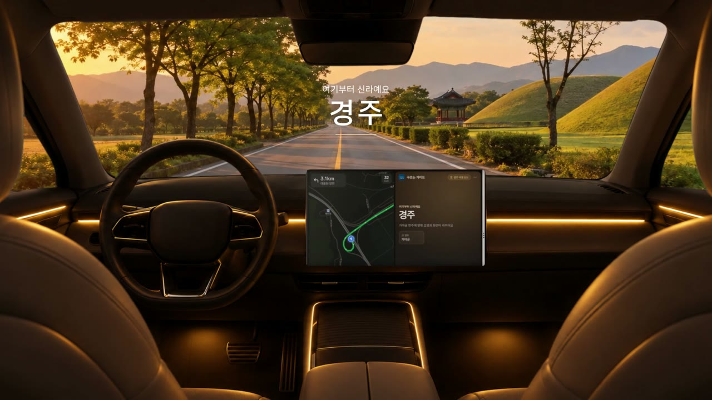
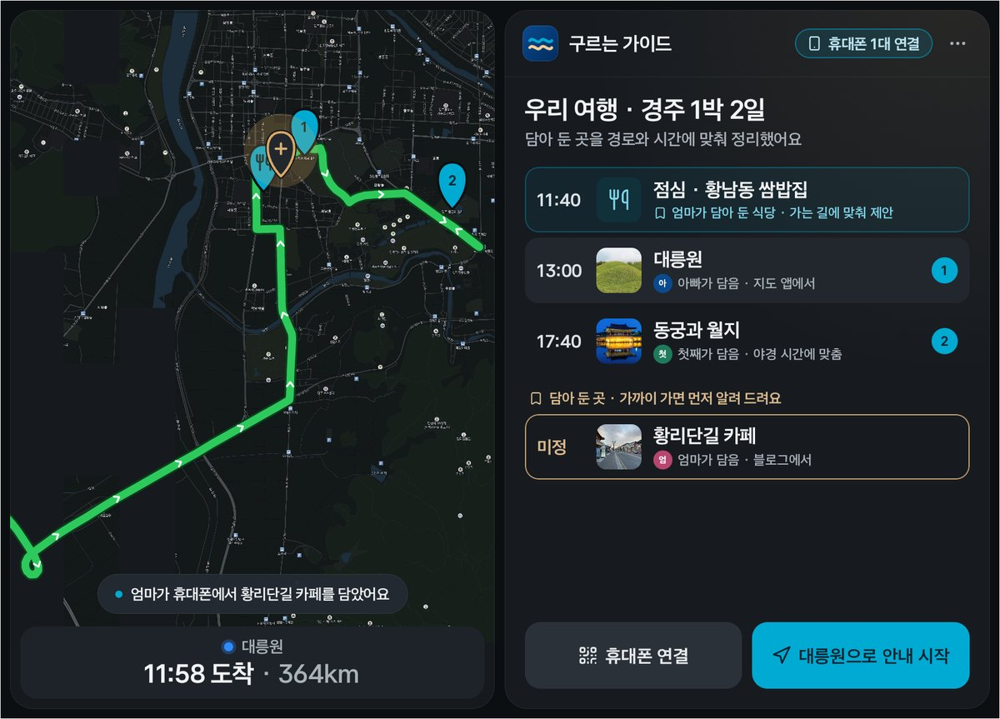
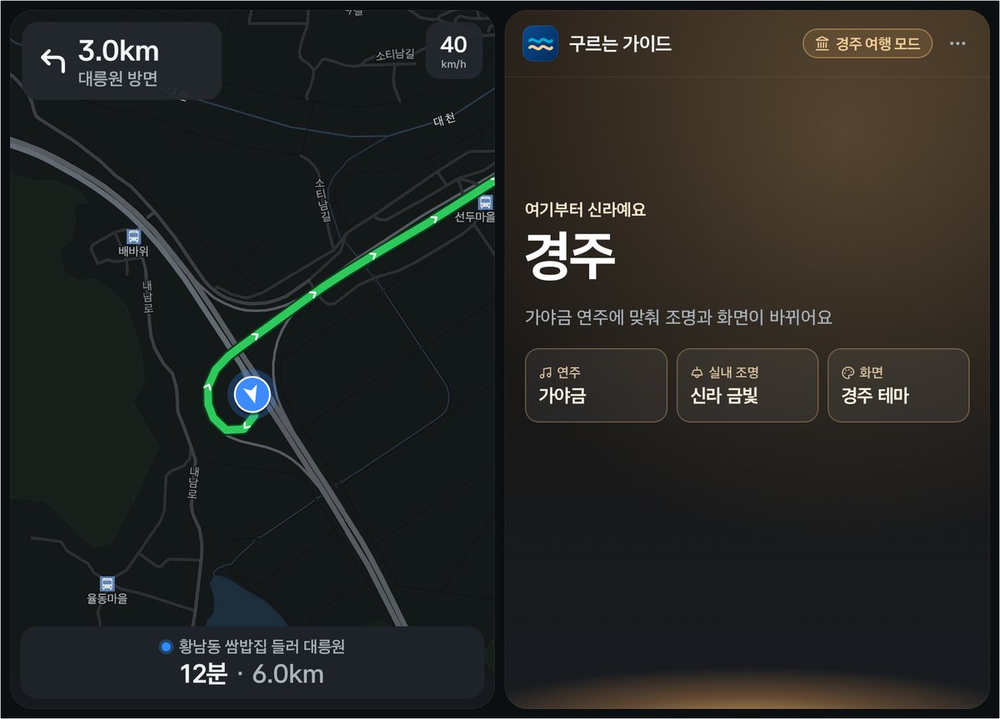
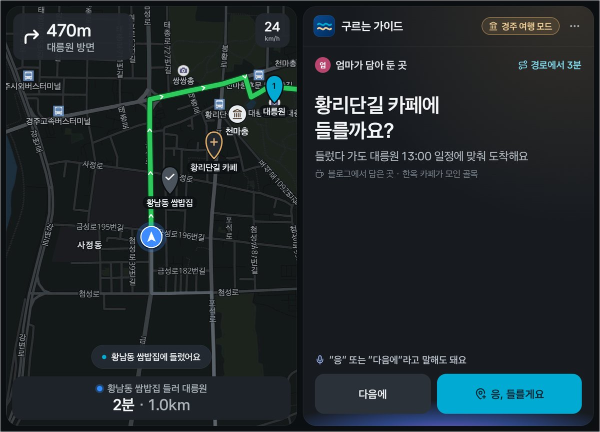
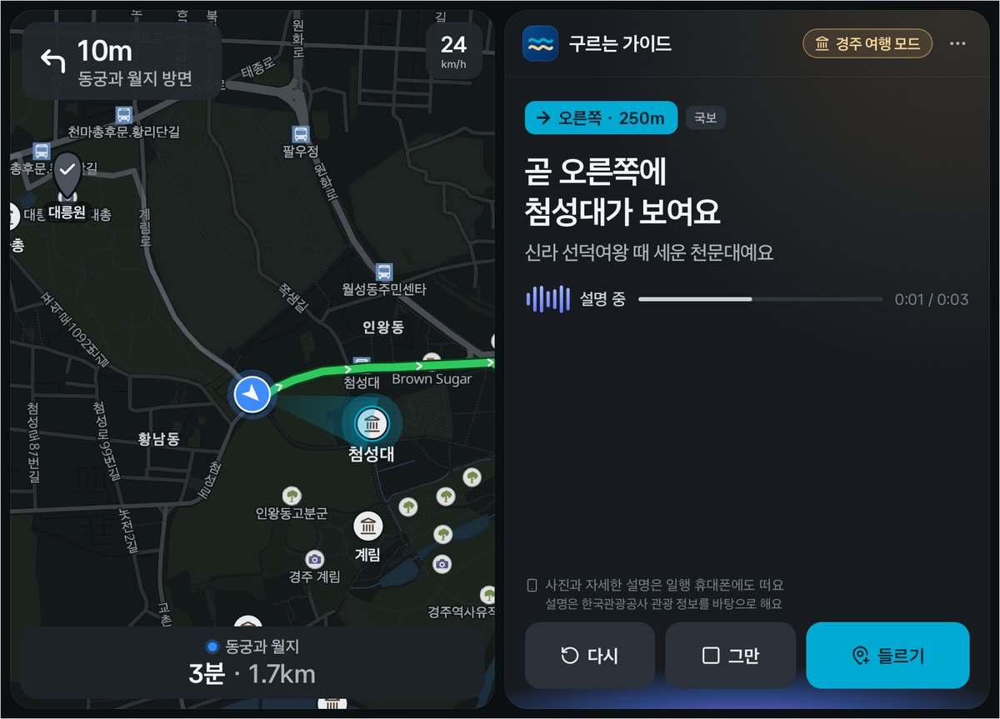
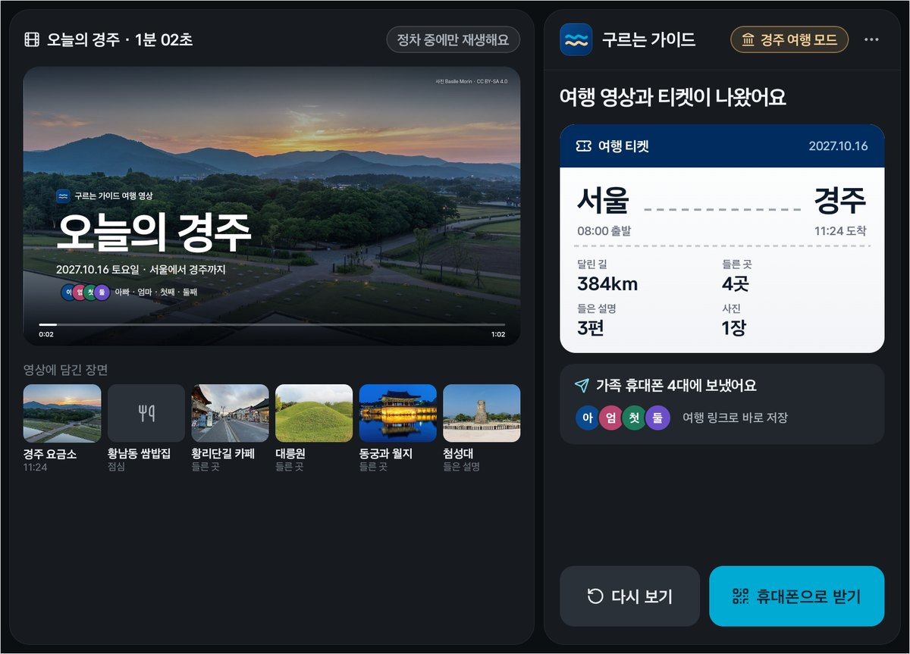
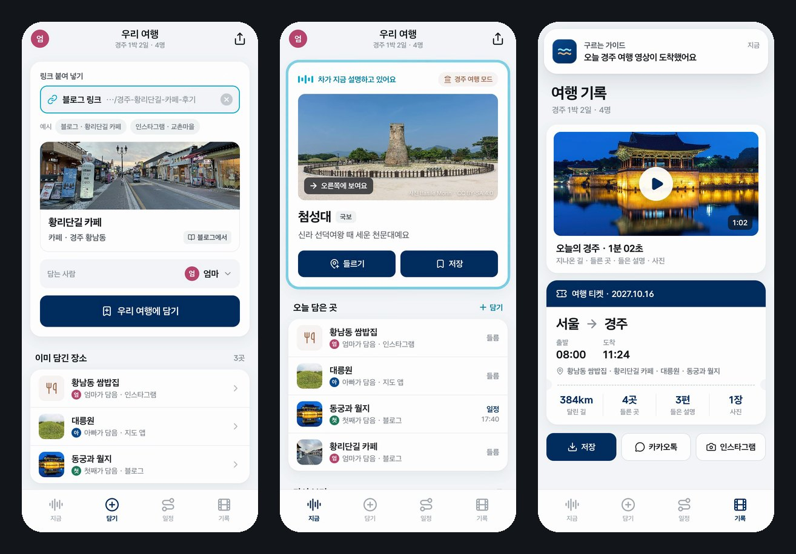

# 구르는 가이드

**내 차의 여행 모드.** 여행 준비부터 명소 안내, 여행 기록까지 차량 데이터와 기능을 연결해 내 차를 여행 전용 모빌리티로 바꾸는 플레오스 커넥트(Pleos Connect) 앱입니다. 현대자동차그룹 차량용 앱 개발 공모전 출품작입니다.

[](https://aikong2024.github.io/gureuneun-guide/)

**시연 영상(1분 58초)**: [apk/구르는가이드_시연영상.mp4](apk/구르는가이드_시연영상.mp4) · [웹에서 보기](https://aikong2024.github.io/gureuneun-guide/)

서울에서 경주로 가는 가족 여행 하루를 따라갑니다. 차량 화면과 휴대폰 화면은 에뮬레이터와 휴대폰 웹을 실제로 돌려 녹화했습니다. 지도 장면은 앱이 쓰는 경주 지도와 경로를 3D로 그린 것이고, 차 실내와 도로 장면은 생성 이미지와 스톡 영상입니다. 목소리는 AI 합성 음성입니다.

## 화면

| 출발 전 '우리 여행' | 요금소를 지나면 여행 모드 |
|---|---|
|  |  |

| 담아 둔 곳 제안 | 지나는 명소 안내 |
|---|---|
|  |  |

| 도착 후 여행 영상과 여행 티켓 | 동승자 휴대폰 |
|---|---|
|  |  |

## 핵심 기능

1. **휴대폰에서 담은 장소를 차량 일정으로** 휴대폰 웹 '우리 여행'에 블로그, 지도 앱, 인스타그램 링크를 붙여 넣으면 차량 일정에 들어옵니다. 시간을 정하지 않은 곳은 근처를 지날 때 차량이 먼저 "들를까요?" 하고 묻고, "응" 하면 내비게이션 경유지로 넣습니다.
2. **여행 모드** 여행지가 가까워지면 실내 조명을 낮추고 짧은 전주를 틉니다. 요금소를 지나면 가야금 연주와 함께 조명 색과 화면이 경주 테마로 바뀝니다.
3. **지나는 명소 안내** 경로 가까이 명소가 있으면 어느 쪽 창밖에 보이는지까지 먼저 알려 줍니다. 방향지시등을 켜면 설명을 멈췄다가 이어 가고, "저 숲은 뭐야?"처럼 물어도 답합니다.
4. **1분 여행 영상과 여행 티켓** 도착하면 이동 경로, 여행지에 들어서던 순간, 들른 곳, 들은 설명, 일행이 올린 사진으로 1분 영상을 만들어 차량 화면에서 틀고 가족 휴대폰으로 보냅니다.

주행 중 차량 화면에는 큰 글씨와 버튼만 띄웁니다. 사진은 동승자 휴대폰과 정차 후 차량 화면에서만, 여행 영상과 QR 코드는 정차 중에만 보여 줍니다.

## 실행 방법

```bash
# 1. 차량 앱 설치 (위치 권한은 처음 실행 때 묻습니다)
adb install -r apk/개인참가_구르는가이드_release.apk

# 2. 휴대폰 웹과 여행 영상 서버 (Node 18 이상, 설치할 패키지 없음)
node companion/server.js
```

1. 앱을 열면 '우리 여행' 일정이 보입니다. 휴대폰 웹은 같은 와이파이에서 `http://<PC 주소>:8787/t/GJ1016` 으로 열리고, 차량 화면의 [휴대폰 연결]에도 QR이 뜹니다.
2. 휴대폰 [담기]에 링크를 붙여 넣으면(예: `https://blog.naver.com/…/경주-황리단길-카페-후기`) 차량 일정의 '담아 둔 곳'에 들어옵니다.
3. 차량 화면의 [대릉원으로 안내 시작]을 누르면 내비게이션에 목적지와 경유지가 들어가고, 경주 요금소 1.5km 앞부터 시연 주행이 시작됩니다.
4. 요금소 통과, 담아 둔 곳 제안, 지나는 명소, 차로 변경 멈춤, 음성 질문, 도착, 여행 영상까지 자동으로 이어집니다.

서버를 켜지 않아도 차량 앱은 끝까지 동작합니다(휴대폰 연동만 빠집니다). 화면 오른쪽 위 [···]에 시연 메뉴(말하기 예시, 방향지시등, 배속, 도착으로 건너뛰기, 처음부터)가 있습니다. 같은 동작을 adb로도 보낼 수 있습니다.

```bash
adb shell am start -n app.gureuneun.guide/.MainActivity --es demo start      # 안내 시작
adb shell am start -n app.gureuneun.guide/.MainActivity --es demo say --es text "저 숲은 뭐야?"
adb shell am start -n app.gureuneun.guide/.MainActivity --es demo reset      # 처음부터
```

## 테스트 환경

| 항목 | 내용 |
|---|---|
| 에뮬레이터 | Pleos Connect Emulator v2.1.0 (Android 14, API 34, arm64) |
| 화면 규격 | 2560×1440, 160dpi. 앱 창 1682×1210(내비게이션 옆 멀티 윈도)과 전체 화면에서 확인 |
| 빌드 | JDK 17 이상(21로 빌드), Android Gradle Plugin 8.7.3, Kotlin 2.0.21, compileSdk 34, minSdk 28 |
| 서버 | Node.js 22 (18 이상), 외부 패키지 없음 |
| 필요한 설정 | 위치 권한 `pleos.car.permission.FUSED_LOCATION`. 에뮬레이터는 `10.0.2.2:8787`로 서버에 붙습니다 |

실차에서는 돌려 보지 못했습니다.

## APK 위치

`apk/개인참가_구르는가이드_release.apk` (release 빌드, 서명 포함)

## 플레오스 커넥트 SDK

| SDK | 쓰는 곳 |
|---|---|
| NaviHelper 3.0.5 | 목적지와 경유지 입력, 다음 길 안내까지 남은 거리 |
| FusedLocation 1.1.3 | 위치 권한과 위치 수신 |
| Vehicle 2.3.2 | 실내 조명 색과 밝기, 방향지시등, 기어 |
| TextToSpeech 3.3.1 | 설명과 제안 음성 |
| SpeechToText 3.3.1 | "응", "다음에", "저기 뭐야?" |

SDK별 연결 코드는 [app/src/main/java/app/gureuneun/guide/sdk](app/src/main/java/app/gureuneun/guide/sdk), 여행 흐름은 [TripEngine.kt](app/src/main/java/app/gureuneun/guide/engine/TripEngine.kt)에 있습니다.

## 시제품이라 대신한 것

- 에뮬레이터의 순정 내비게이션 지도가 비어 있어 앱이 오프라인 지도를 직접 그립니다.
- 에뮬레이터 GPS가 움직이지 않아 실제 도로를 따라 위치를 흘려 넣는 시연 주행을 씁니다.
- 명소 설명은 한국관광공사 관광 정보를 바탕으로 미리 다듬어 둔 문장입니다. 서비스에서는 TourAPI와 생성형 AI로 만듭니다.
- 링크 속 장소 찾기는 장소 목록(`companion/web/data/places.json`)으로 대신합니다. 서비스에서는 카카오 로컬 API를 씁니다.
- 여행 영상은 HTML 애니메이션으로 만들어 차량(WebView)과 휴대폰에서 같은 파일로 재생합니다.

## 빌드

```bash
./gradlew assembleRelease    # local.properties 에 sdk.dir, 서명은 keystore.properties (없으면 디버그 키)
```

## 시연 영상 만들기

에뮬레이터와 휴대폰 웹을 같은 시각에 녹화하고([tools/demo](tools/demo)), HyperFrames로 장면을 짜서 렌더합니다([tools/film](tools/film)). 차가 달리는 지도 장면은 앱 지도 타일과 경로를 three.js로 그립니다.

```bash
EMU=1 EVERY=250 node tools/demo/record_all.mjs         # 차량 화면(초당 4장)과 휴대폰 화면 녹화 → /tmp/rec
node tools/demo/reel_rec.mjs                           # 여행 영상 녹화
python3 tools/film/media.py /tmp/rec tools/film/assets # 녹화를 30fps 재료로
python3 tools/film/world.py                            # 3D 지도 재료 (경로, 지도 텍스처)
python3 tools/film/build.py /tmp/rec                   # 장면 HTML, 소리 믹스
python3 tools/film/render.py apk/구르는가이드_시연영상.mp4
```

음악(tools/film/assets/music.mp3)과 주행 영상(tools/film/assets/stock_road_1.mp4)은 저장소에 없으니 아래 출처에서 받아 넣어야 합니다.

## 출처

- 사진: 위키미디어 공용. 촬영자와 라이선스는 [companion/web/photos/credits.json](companion/web/photos/credits.json)
- 지도: © OpenMapTiles © OpenStreetMap contributors, OpenFreeMap
- 글꼴: Asta Sans (42dot, SIL Open Font License 1.1)
- 아이콘: Lucide (ISC License)
- 앱 소리: 전주와 연주곡, 여행 영상 배경음은 직접 합성했습니다 ([tools/assets/make_audio.py](tools/assets/make_audio.py))
- 시연 영상 배경 음악: Kulakovka, "Chill Reel" (Pixabay Content License)
- 시연 영상 주행 장면: Ambient_Nature_ Atmosphere, "Vehicle Traveling on Roadway" (Pexels License)
- 시연 영상 목소리: OpenAI 음성 합성(openai.fm)으로 만든 AI 음성 ([tools/film/voice](tools/film/voice))
- 시연 영상 차 실내, 요금소, 도로 이미지: ChatGPT 이미지 생성 ([tools/film/plates](tools/film/plates))
- 오픈소스: Jetpack Compose, OkHttp, ZXing (Apache-2.0), HyperFrames (Apache-2.0, 시연 영상 편집), three.js (MIT, 시연 영상 3D 지도)

