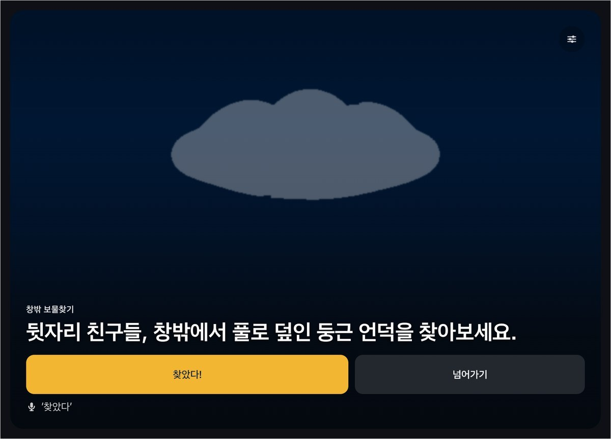
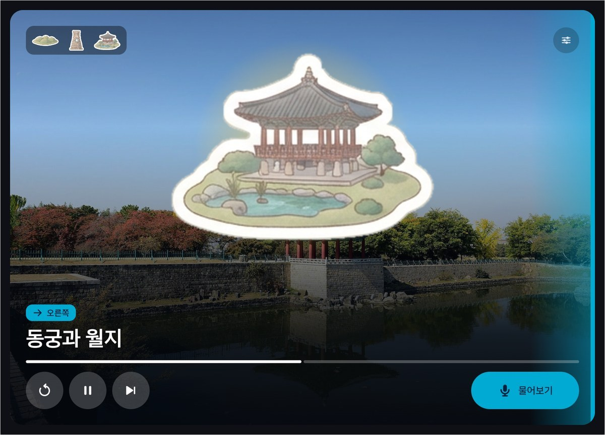
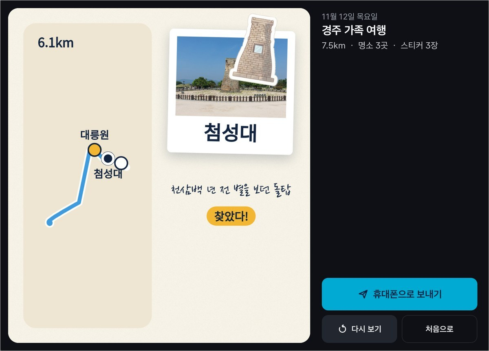
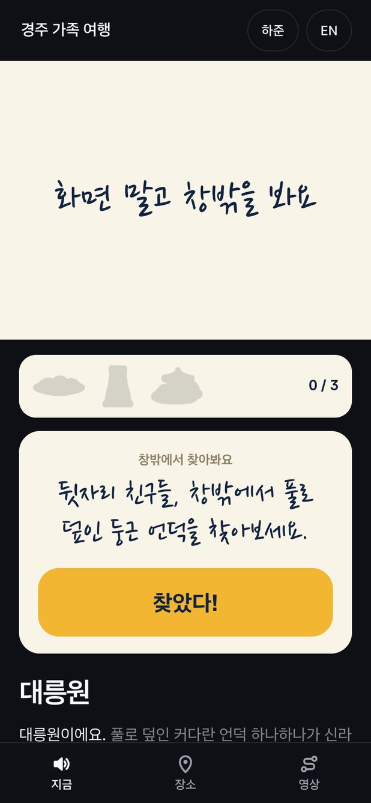
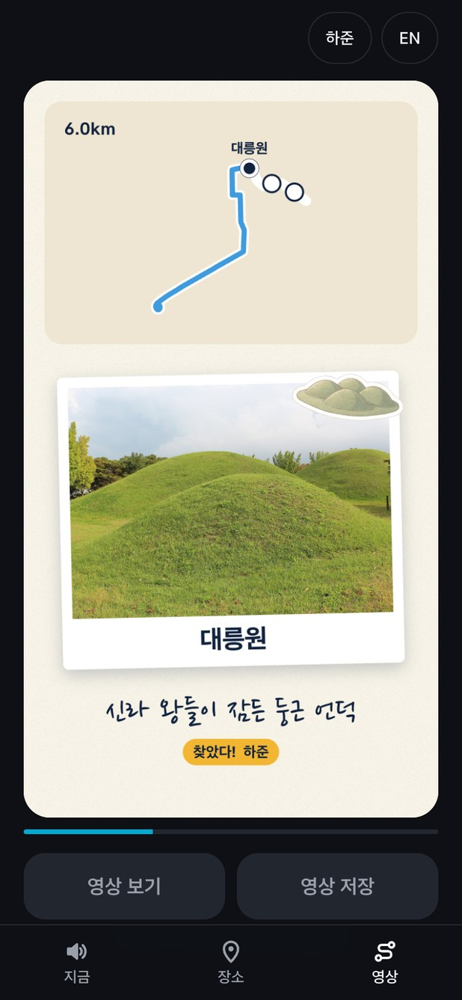

# 구르는 가이드

**버튼 하나면 차가 여행 가이드가 됩니다.**

차가 지나는 곳마다 어느 쪽 창밖에 무엇이 보이는지 먼저 알려 주고 그곳 이야기를 들려줍니다. 아이가 타면 창밖 보물찾기가 시작되고, 도착하면 오늘 지나온 길이 영상 한 편으로 남습니다. Pleos Connect 앱이고 현대자동차그룹 차량용 앱 개발 공모전 출품작입니다.

## 시연 영상

[](https://aikong2024.github.io/gureuneun-guide/)

[2분짜리 영상](https://aikong2024.github.io/gureuneun-guide/)입니다. Pleos Connect 에뮬레이터에서 앱이 돌아가는 화면과 차가 낸 안내 음성을 그대로 담았습니다. 녹화 중에는 마이크를 쓸 수 없어서 질문 목소리는 음성 파일을 SpeechToText SDK에 넣었습니다. 아이 모드와 여행 영상을 넣기 전에 찍은 것이라 곧 다시 찍습니다.

## 화면

| 여행지를 고르고 [여행 시작] | 출발 전에는 QR과 오늘 코스 | 명소 앞에서는 보이는 쪽부터 |
|---|---|---|
|  |  |  |

| 아이 모드: 창밖에서 찾을 것 | "찾았다!"에 스티커 한 장 | 도착하면 오늘의 여행 영상 |
|---|---|---|
|  |  |  |

| 물어보면 코스 밖 볼거리도 답함 | 휴대폰에서 고른 곳은 "응" 한마디로 |
|---|---|
|  |  |

내비게이션 옆 절반 창에서도 그대로 씁니다.


함께 탄 사람의 휴대폰입니다. 앱을 깔지 않고 QR로 들어옵니다.

<p>




</p>

## 하는 일

- [여행 시작]을 누르면 목적지와 경유지가 순정 내비게이션에 들어갑니다. 기어를 D로 옮기면 안내가 시작됩니다.
- 명소에 가까워지면 "잠시 후 오른쪽에 첨성대가 보여요" 하고 알려 준 뒤 이야기를 들려줍니다. 길 안내가 나오거나 방향지시등을 켜면 잠깐 멈춥니다.
- [물어보기]를 누르고 "오른쪽에 보이는 거 뭐야?" 하고 물으면 그쪽에 보이는 곳을 찾아 답합니다.
- 뒷자리에 누가 앉으면 아이 모드로 갈지 묻습니다. 켜면 명소마다 창밖에서 찾을 것을 냅니다. "찾았다!" 하면 실내 조명이 금빛으로 바뀌고 스티커가 한 장 모입니다. 찾는 동안에는 차 화면도 휴대폰도 사진을 가립니다.
- 차가 "네모난 창" 같은 대목을 읽을 때 휴대폰 사진 위 그 자리에 동그라미가 그려집니다.
- 함께 탄 사람이 휴대폰에서 카페나 주차장을 고르면 차가 운전자에게 묻습니다. "응" 한마디면 내비게이션에 들어갑니다.
- 안내 언어를 영어로 바꾸면 이야기와 묻고 답하기가 영어로 바뀝니다. 운전자 화면은 그대로입니다.
- 목적지에 세우면 여행을 끝낼지 묻고, 지나온 길과 들른 곳, 모은 스티커, 함께 탄 사람이 올린 사진을 영상 한 편으로 틉니다. 휴대폰에서는 영상 파일로 저장합니다.

앱이 차에서 바꾸는 것은 실내 조명 하나이고 여행이 끝나면 원래대로 돌려 둡니다. 여행 영상은 차가 서 있을 때만 틉니다. 차의 실시간 위치는 서버로 보내지 않고, 여행 기록은 운전자가 [휴대폰으로 보내기]를 눌러야 올라갑니다.

## 쓰는 Pleos Connect SDK

| SDK | 쓰는 곳 |
|---|---|
| Vehicle 2.3.2 | 기어, 방향지시등, 와이퍼, 전조등, 뒷좌석 착석을 읽고 실내 조명 색과 밝기를 바꿈 |
| NaviHelper 3.0.5 | 목적지와 경유지 넣기, 다음 길 안내까지 남은 거리 |
| FusedLocation 1.1.3 | 명소마다 근접 알림 |
| TextToSpeech 3.3.1 | 이야기 읽기 (한국어, 영어) |
| SpeechToText 3.3.1 | 질문과 "응", "찾았다" 알아듣기 (한국어, 영어) |

SDK마다 [app/src/main/java/app/gureuneun/guide/sdk](app/src/main/java/app/gureuneun/guide/sdk)에 파일이 하나씩 있고, 여행 흐름은 [TripEngine.kt](app/src/main/java/app/gureuneun/guide/engine/TripEngine.kt)에 있습니다. 여행 영상은 [companion/web/reel](companion/web/reel)의 웹 화면 하나를 차(WebView)와 휴대폰이 같이 씁니다.

## 실행

```bash
adb install -r -g apk/개인참가_구르는가이드_release.apk
adb forward tcp:8088 tcp:8088               # Virtual Console: http://127.0.0.1:8088
cd companion && npm install && npm start    # 휴대폰 화면을 볼 때만
```

1. 여행지를 고르고 [여행 시작]을 누릅니다.
2. Virtual Console에서 기어를 D로 옮기면 출발합니다. 에뮬레이터는 GPS가 움직이지 않아서 실제 도로를 따라 위치를 흘려 넣습니다.
3. 차 화면의 QR 주소를 PC 브라우저나 같은 와이파이의 휴대폰으로 엽니다.
4. 휴대폰 [장소]에서 카페를 골라 보내면 차가 묻습니다. [영상]에서는 사진을 올립니다.
5. 기어를 P로 옮기면 정차 화면이 나오고, 마지막 목적지라면 여행을 끝낼지 묻습니다. 끝내면 여행 영상이 시작됩니다.

달리는 화면 오른쪽 위 단추에 다음 명소 앞으로 가기, 질문 음성 넣기 같은 시연 도구가 있습니다. 창밖 보물찾기는 차 화면이나 휴대폰의 [찾았다!]를 눌러도 됩니다.

## 확인한 것

- Pleos Connect v2.1.0 에뮬레이터(Android 14, 2560x1440)의 넓은 창과 절반 창
- 단위 시험 28개: `./gradlew :app:testDebugUnitTest`
- 세 코스를 에뮬레이터에서 처음부터 끝까지 돌리는 흐름 시험 60항목: [tools/demo/flow.mjs](tools/demo/flow.mjs)
- 실차에서는 돌려 보지 못했습니다.

## 빌드

```bash
./gradlew :app:assembleRelease    # JDK 17, local.properties 에 sdk.dir
```

영상은 [tools/demo](tools/demo)의 record.mjs로 녹화하고 compose.py로 편집했습니다. 녹화 도구는 adb로 앱을 움직이는데, release 빌드에서는 처음 화면 오른쪽 위 [점검]에서 [시연 명령 받기]를 켜야 받습니다.

## 출처

- 이야기: 위키백과와 한국관광공사 대한민국 구석구석에서 확인한 사실만 썼습니다. 생성형 AI는 길이와 말투를 다듬는 데 썼습니다.
- 사진: 위키미디어 공용. 찍은 사람과 라이선스는 [docs/PHOTO_CREDITS.md](docs/PHOTO_CREDITS.md)
- 스티커 그림 8종: Gemini로 그린 것을 잘라 썼습니다.
- 지도와 경로: © OpenStreetMap 기여자, OSRM
- 영상 음악: Pixabay, Acoustic Guitar (saavane)
- 오픈소스: Leaflet (BSD-2-Clause), ZXing, OkHttp, Jetpack Compose (Apache-2.0), ws (MIT), Asta Sans, 나눔손글씨 펜 (OFL)
